> [!IMPORTANT]
>  **Move to SnipArc**
>
> **November 28, 2026** · Switch to **SnipArc**, our next-generation screenshot and annotation app. We’ll continue to maintain and improve it.
>
> **[Download SnipArc](https://sniparc.mosuzo.com/)** · [Explore more from Mosuzo Studio](https://mosuzo.com/)

---

# SunnyCapturer

A screenshot tool for Windows, macOS, and Linux with annotation, image pinning, offline OCR, image translation, screen recording, and GIF export.

**Latest release v5.3.0** · Qt / C++ · About 40,000 GitHub downloads

[Original project website](https://sunnycapturer.xmuli.tech/) · [GitHub Releases](https://github.com/XMuli/SunnyCapturer/releases) · [Project archive](https://screenshot-archive.xmuli.tech/sunnycapturer/) · [简体中文](README.zh_CN.md)

## App store history

| Store | Platform and listing |
| --- | --- |
|  **Microsoft Store** | Windows · [SunnyCapturer](https://apps.microsoft.com/detail/9N1TPFK4NCBL) |
| 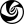 **Deepin Store** | Linux · Search for SunnyCapturer or Sunny in the store |
| **UOS Store** | Linux · Search for SunnyCapturer or Sunny in the store |
| **Spark Store** | Linux · Search for SunnyCapturer or Sunny in the store |

The compatibility list also mentions openKylin Store. A published listing could not be verified.

## Operating system compatibility

| Platform | Versions in the compatibility list | Architectures |
| --- | --- | --- |
|  **Windows** | 7, 8, 8.1, 10, 11, and selected Windows Server editions from 2008 R2 to 2025 | x86-64 · ARM64 |
| 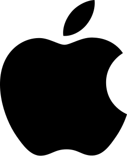 **macOS** | 13 Ventura · 14 Sonoma · 15 Sequoia | Intel · Apple Silicon (release-dependent) |
|  **Linux** | See the distributions below | x86-64 · AArch64 · LoongArch64 |

Windows 7 support is limited to releases 1.x–2.x. See the assets for each release for available platform and architecture combinations.

### Linux distributions

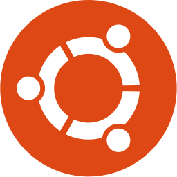 &nbsp;  &nbsp; 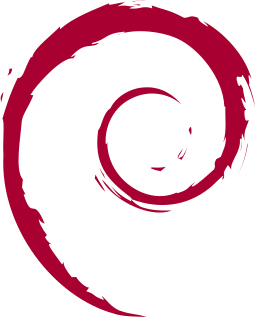 &nbsp; 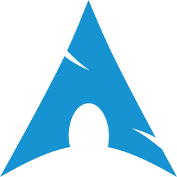 &nbsp;  &nbsp; 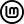 &nbsp; 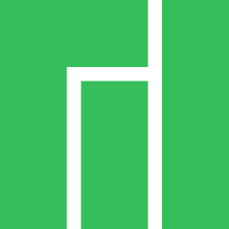 &nbsp; 

 &nbsp; 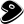 &nbsp;  &nbsp; 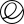 &nbsp; 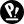 &nbsp; 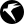 &nbsp; 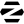

- **Version examples:** Debian 11 and 12, Ubuntu 20.04, 22.04 and 24.04 LTS, Deepin 20.7–20.9, 23 and 25, openKylin 1.0.2 and 2.0, and CentOS 7.
- **Other entries in the compatibility list:** Arch Linux, BigLinux, CachyOS, Desktop Linux, Devuan, elementary OS, Fatdog64, Fedora, Gentoo, GXDE OS, Kali Linux, Kamuriki, KDE neon, Linux Mint, LMDE 6, Manjaro, NFSDesktop, Nobara, openEuler, openSUSE Leap, Parrot Security, Pop!_OS, Salix, Tongwandou, TUXEDO, UOS, Windows Ubuntu, and Zorin OS.

## Screenshots by operating system

Select a screenshot to view it at full size. See [supported operating systems](./supported_os.md) for the full compatibility list.

### Windows 11

 <a href="./_media/images/run_exhibition/win11_02.jpg">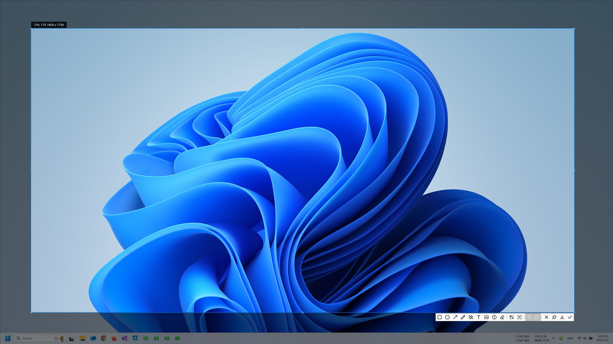</a>

### macOS 13

<a href="./_media/images/run_exhibition/macOS13_01.jpg">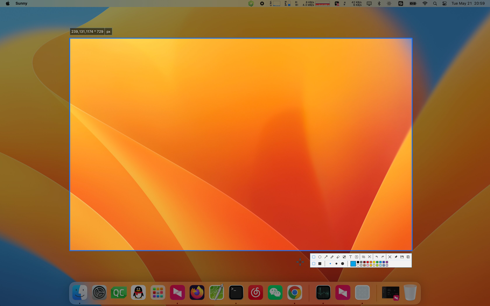</a> <a href="./_media/images/run_exhibition/macOS13_02.jpg">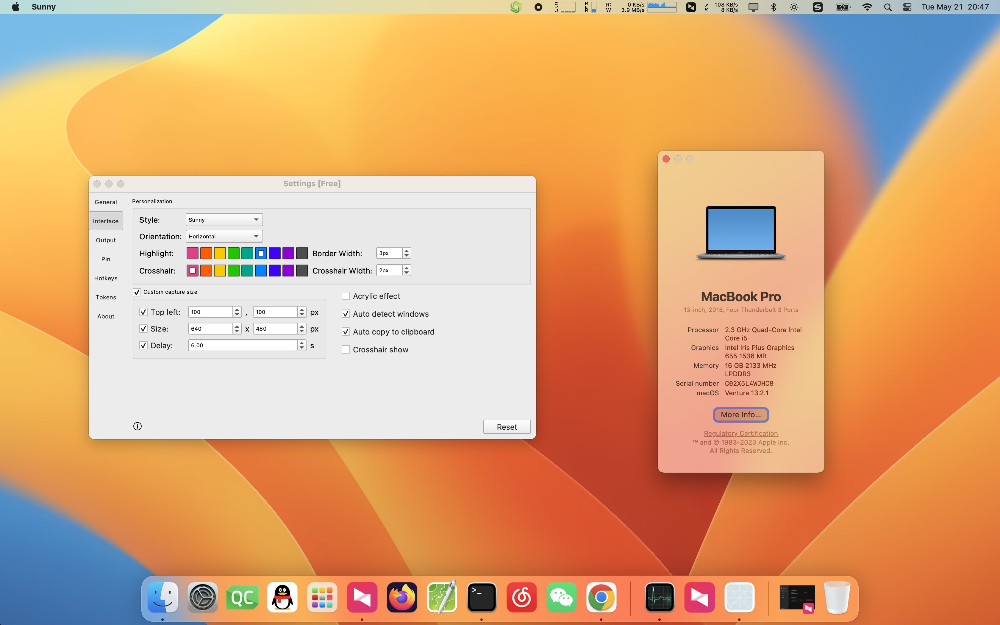</a>

### Debian 12

<a href="./_media/images/run_exhibition/Debian12_01.jpg">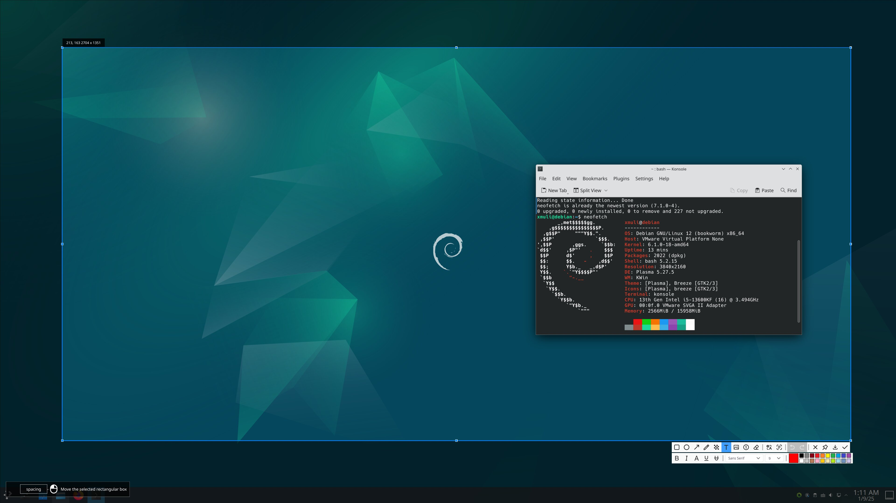</a> <a href="./_media/images/run_exhibition/Debian12_02.jpg">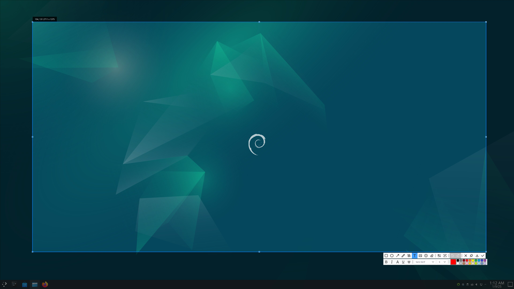</a>

### Ubuntu 20.04

<a href="./_media/images/run_exhibition/Ubuntu20.04_01.jpg">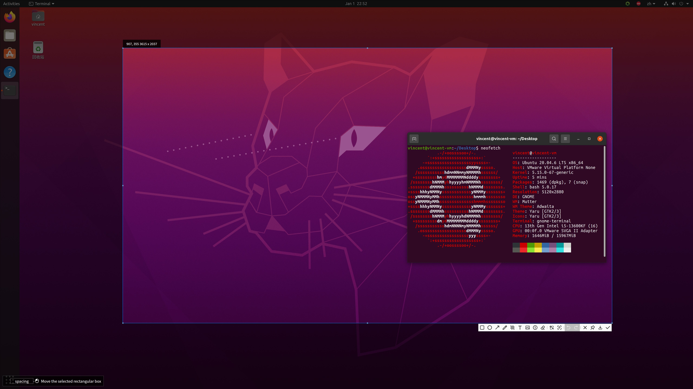</a> 

<a href="./_media/images/run_exhibition/Ubuntu20.04_03.jpg">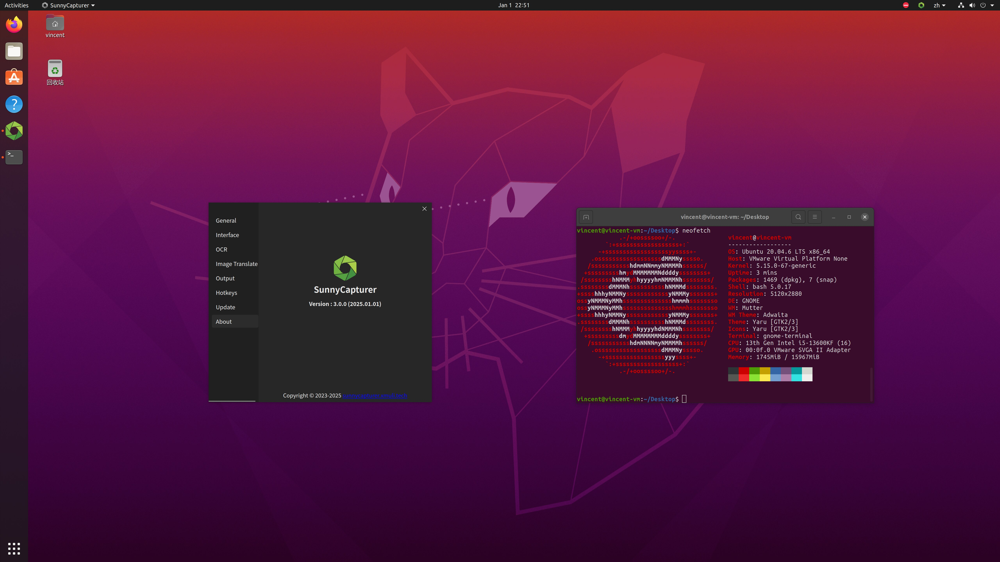</a>

### Ubuntu 24.04

<a href="./_media/images/run_exhibition/Ubuntu24.04_01.jpg">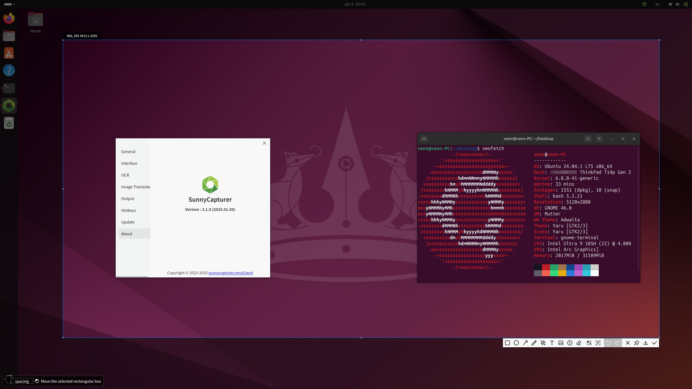</a> <a href="./_media/images/run_exhibition/Ubuntu24.04_02.jpg">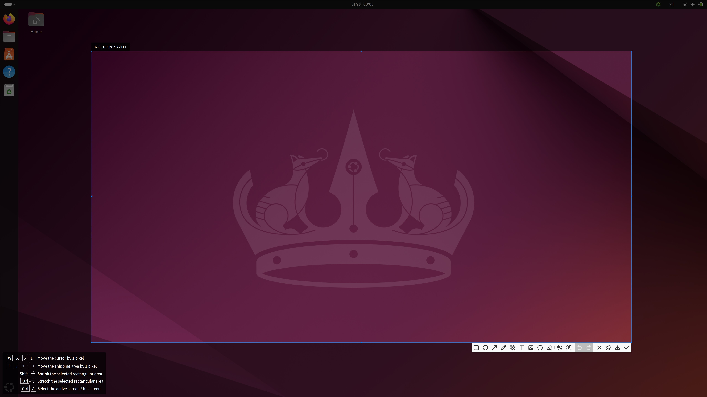</a>

<a href="./_media/images/run_exhibition/Ubuntu24.04_03.jpg">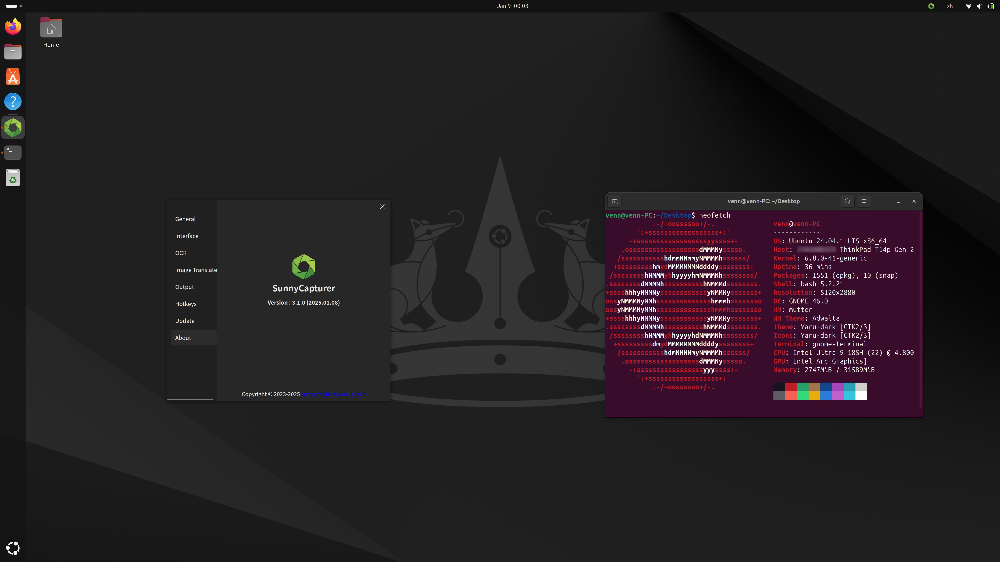</a> <a href="./_media/images/run_exhibition/Ubuntu24.04_04.jpg">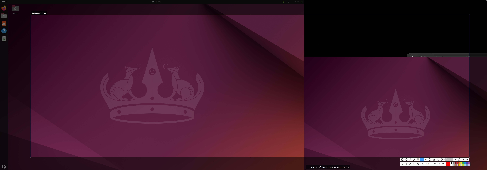</a>

### Deepin V23

<a href="./_media/images/run_exhibition/Deepin23_01.jpg">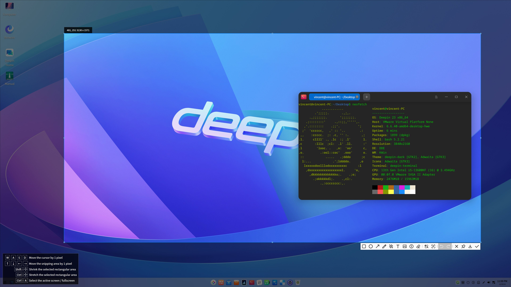</a> <a href="./_media/images/run_exhibition/Deepin23_02.jpg">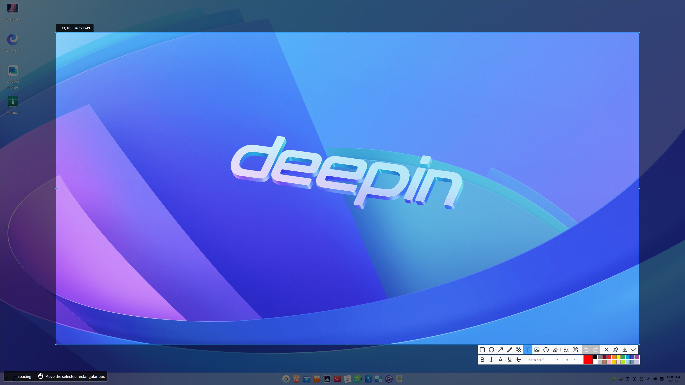</a>

### openKylin 2.0

<a href="./_media/images/run_exhibition/OpenKylin2.0_01.jpg">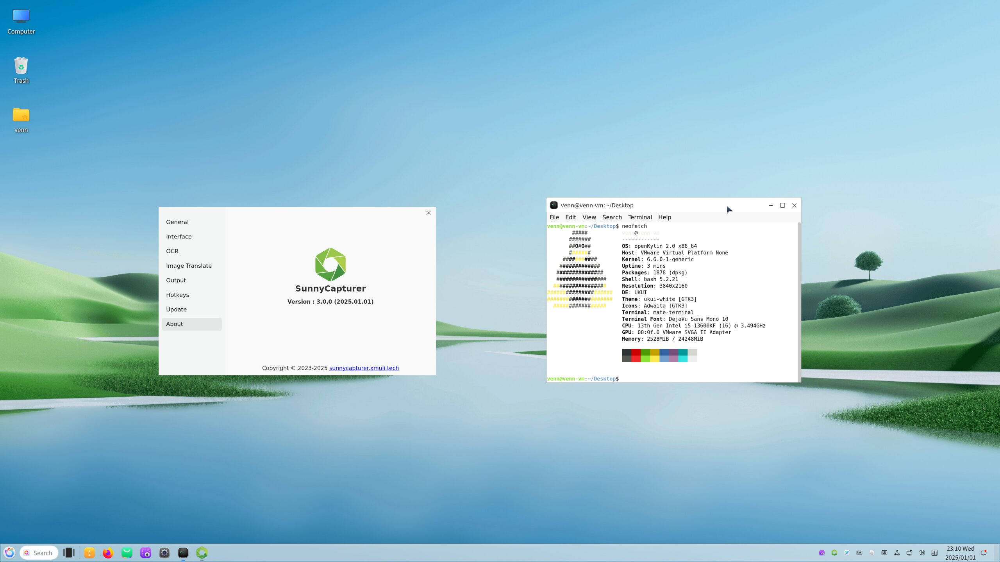</a>

### Deepin V23 · ARM64

<a href="./_media/images/run_exhibition/ARM64_Deepin_V23.jpg">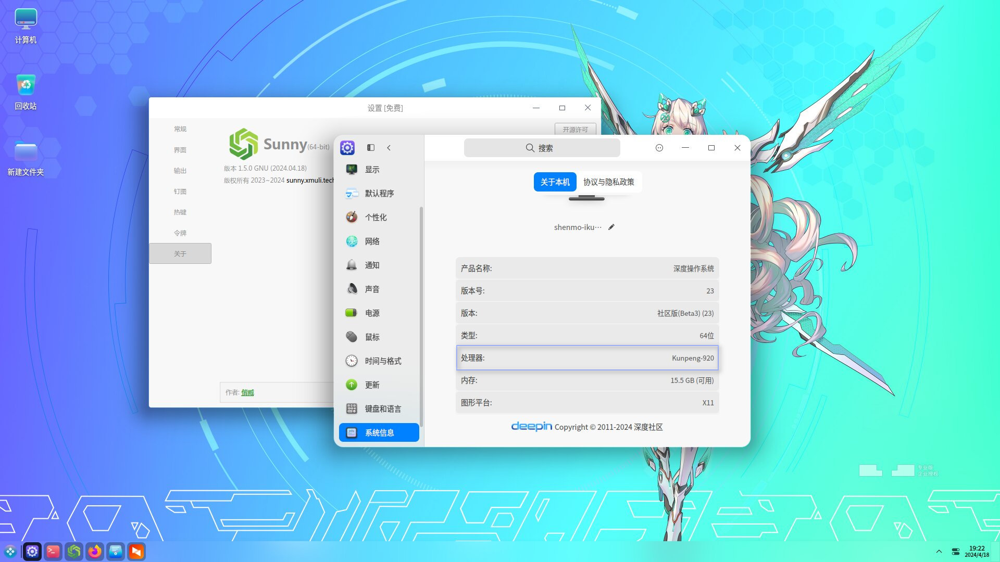</a>

### Deepin V23 · Loongson

## Status

SunnyCapturer no longer receives feature updates. Use **SnipArc** for ongoing development on Windows.

## Links

| | |
| --- | --- |
| **Website** | https://sunnycapturer.xmuli.tech/ |
| **Full compatibility list** | https://sunnycapturer.xmuli.tech/legacy-site.html#/supported_os |
| **Archive entry** | https://screenshot-archive.xmuli.tech/sunnycapturer/ |
| **GitHub** | https://github.com/XMuli/SunnyCapturer |
| **Releases** | https://github.com/XMuli/SunnyCapturer/releases |

## The screenshot series

ShotX → FLIPPED → Sunny → SunnyCapturer → SnipArc.  
[Full visual archive](https://screenshot-archive.xmuli.tech/)

## License

Copyright (c) 2023–2026 WENGENG ZHANG

Original SunnyCapturer code and documentation are available under the [GNU GPL v3.0](./LICENSE) (GPL-3.0-only). Historical source snapshots and third-party components retain their own license notices.

## Contact

- **Mosuzo Studio** — https://mosuzo.com/
- **GitHub** — https://github.com/XMuli
- **QQ group** — 418103279 · https://qm.qq.com/q/ff0xkauRdm
