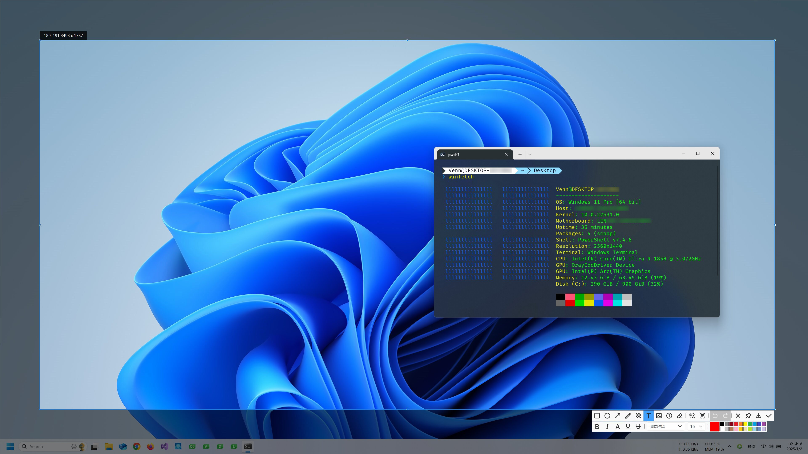
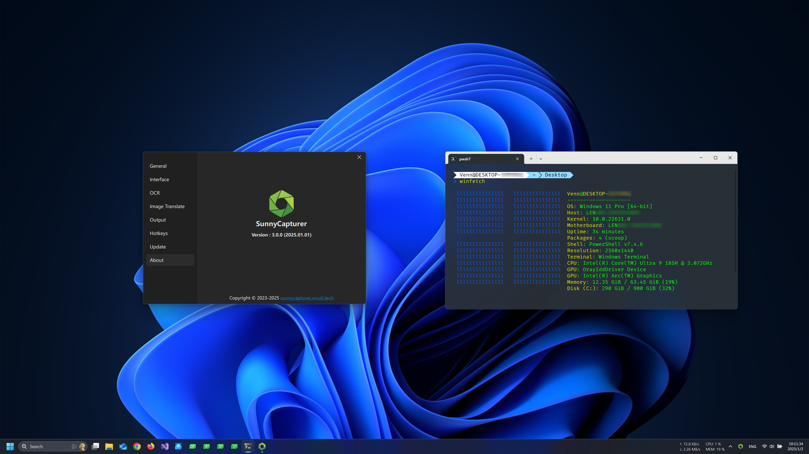
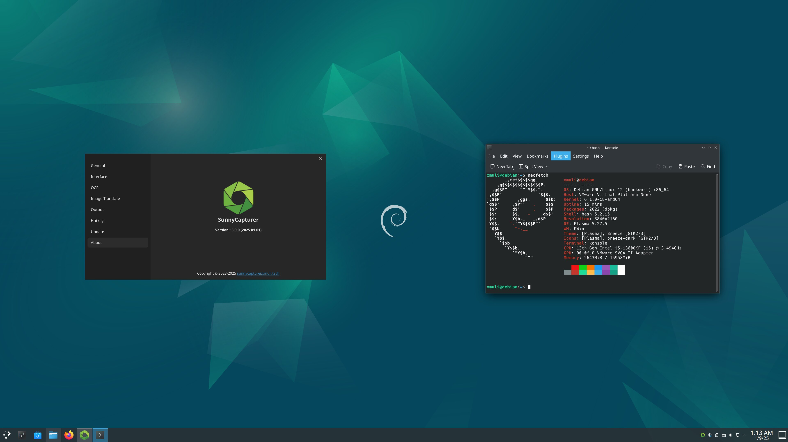
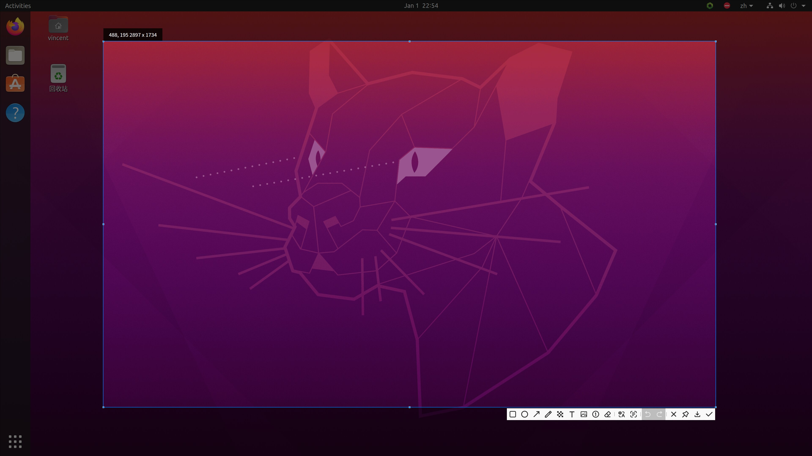
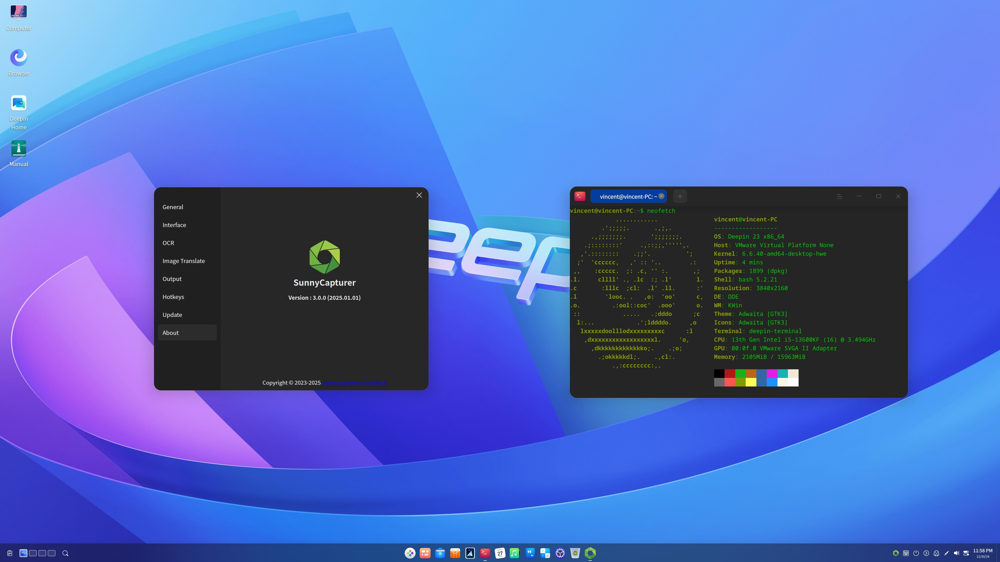
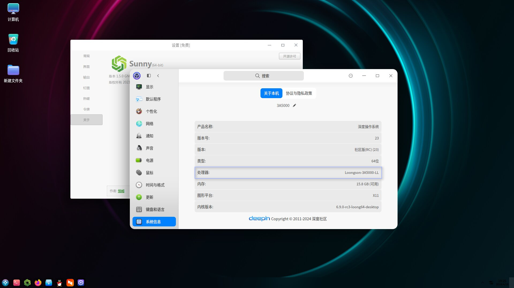

> [!IMPORTANT]
>  **Move to SnipArc**
>
> **November 28, 2026** · Switch to **SnipArc**, our next-generation screenshot and annotation app. We’ll continue to maintain and improve it.
>
> **[Download SnipArc](https://sniparc.mosuzo.com/)** · [Explore more from Mosuzo Studio](https://mosuzo.com/)

---

# SunnyCapturer

[Original project website](https://sunnycapturer.xmuli.tech/)

<a href="README.md">English</a> · <a href="README.zh_CN.md">简体中文</a>

          

> **Archived.** The 5.x generation: screenshot, annotation, pinning, OCR, translation, recording and GIF in one tool.
>
> Latest release **v5.3.0** · Qt / C++ · Windows, macOS, Linux

## Overview

SunnyCapturer is the most complete tool in the series. It keeps the screenshot, annotation and pinning workflow, adds offline OCR and image translation, and extends capture into screen recording and GIF export.

It shipped on Windows, macOS and Linux, reached the Microsoft Store and several Linux app stores, and gathered roughly 40K GitHub downloads. v5.3.0 is the latest release; the project is now archived.

## Highlights

- Screenshot, annotation, pinning and image editing
- Offline OCR and image translation
- Screen recording and GIF export
- Cross-platform: Windows, macOS and Linux
- Listed in Microsoft Store, Deepin/UOS and Spark stores
- Around 40K GitHub downloads
- Latest release v5.3.0

## Operating system compatibility

| Platform | Versions recorded in the compatibility list | Architectures |
| --- | --- | --- |
| Windows | 7, 8, 8.1, 10, 11, and selected Windows Server editions from 2008 R2 to 2025 | x86-64 and ARM64, depending on the build |
| macOS | 13 Ventura, 14 Sonoma, and 15 Sequoia | Intel; Apple Silicon support varies by release |
| Linux | See the distribution list below | x86-64, AArch64, and LoongArch64, depending on the build |

The [full compatibility list](./supported_os.md) covers releases across the project's history. Windows 7 support is limited to the 1.x–2.x releases. Check the [release assets](https://github.com/XMuli/SunnyCapturer/releases) for the architecture and package available for each version.

### Linux distributions

- **Version examples:** Debian 11 and 12, Ubuntu 20.04, 22.04 and 24.04 LTS, Deepin 20.7–20.9, 23 and 25, openKylin 1.0.2 and 2.0, and CentOS 7.
- **Other entries in the compatibility list:** Arch Linux, BigLinux, CachyOS, Desktop Linux, Devuan, elementary OS, Fatdog64, Fedora, Gentoo, GXDE OS, Kali Linux, Kamuriki, KDE neon, Linux Mint, LMDE 6, Manjaro, NFSDesktop, Nobara, openEuler, openSUSE Leap, Parrot Security, Pop!_OS, Salix, Tongwandou, TUXEDO, UOS, Windows Ubuntu, and Zorin OS.

### App stores and downloads

| Platform | Documented distribution channels |
| --- | --- |
| Windows | [Microsoft Store — SunnyCapturer](https://apps.microsoft.com/detail/9N1TPFK4NCBL) |
| Linux | Deepin Store, UOS Store, and Spark Store. Search for **SunnyCapturer** or **Sunny** in the store client. |
| Windows, macOS, and Linux | [GitHub Releases](https://github.com/XMuli/SunnyCapturer/releases) |

The compatibility page also lists openKylin Store, but a published listing could not be verified.

## Screenshots by operating system

Select a screenshot to view it at full size. See [supported operating systems](./supported_os.md) for the full compatibility list.

### Windows 11

 

### macOS 13

 

### Debian 12

 

### Ubuntu 20.04

 

### Ubuntu 24.04

 

 

### Deepin V23

 

### openKylin 2.0

### Deepin V23 · ARM64

### Deepin V23 · Loongson

## Status

SunnyCapturer is archived and no longer receives feature updates. Use **SnipArc** for ongoing development on Windows.

## Links

| | |
| --- | --- |
| **Website** | https://sunnycapturer.xmuli.tech/ |
| **Full compatibility list** | https://sunnycapturer.xmuli.tech/legacy-site.html#/supported_os |
| **Archive entry** | https://screenshot-archive.xmuli.tech/sunnycapturer/ |
| **GitHub** | https://github.com/XMuli/SunnyCapturer |
| **Releases** | https://github.com/XMuli/SunnyCapturer/releases |

## The screenshot series

ShotX → FLIPPED → Sunny → SunnyCapturer → SnipArc.  
[Full visual archive](https://screenshot-archive.xmuli.tech/)

## Contact

- **Mosuzo Studio** — https://mosuzo.com/
- **GitHub** — https://github.com/XMuli
- **QQ group** — 418103279 · https://qm.qq.com/q/ff0xkauRdm
