> [!IMPORTANT]
>  **从这里迁移到 SnipArc**
>
> **2026.11.28** · 欢迎迁移到下一代截图与标注工具 **SnipArc**。我们会持续更新和维护 SnipArc，欢迎下载体验。
>
> **[下载 SnipArc](https://sniparc.mosuzo.com/)** · [探索 Mosuzo Studio 的更多作品](https://mosuzo.com/)

---

# SunnyCapturer

[原项目官网](https://sunnycapturer.xmuli.tech/)

<a href="README.zh_CN.md">简体中文</a> · <a href="README.md">English</a>

          

> **已归档。** 5.x 一代：把截图、标注、贴图、OCR、翻译、录屏与 GIF 收进同一个工具。
>
> 最新版本 **v5.3.0** · Qt / C++ · Windows、macOS、Linux

## 简介

SunnyCapturer 是系列里功能最完整的一代：保留截图、标注与贴图流程，加入离线 OCR 与图片翻译，并把记录屏幕的方式扩展到录屏与 GIF。

它覆盖 Windows、macOS 与 Linux，上架 Microsoft Store 与多个 Linux 应用商店，GitHub 下载约 4 万次。v5.3.0 为最新版本，项目现已归档。

## 亮点

- 截图、标注、贴图与图片编辑
- 离线 OCR 与图片翻译
- 录屏与 GIF 导出
- 跨平台：Windows、macOS 与 Linux
- 上架 Microsoft Store、深度/统信商店与星火商店
- GitHub 下载约 4 万次
- 最新版本 v5.3.0

## 操作系统兼容性

| 平台 | 兼容清单记录的版本 | 架构 |
| --- | --- | --- |
| Windows | 7、8、8.1、10、11，以及 Windows Server 2008 R2 至 2025 的部分版本 | x86-64 和 ARM64，具体以发行包为准 |
| macOS | 13 Ventura、14 Sonoma、15 Sequoia | Intel，Apple Silicon 支持因版本而异 |
| Linux | 见下方发行版列表 | x86-64、AArch64 和 LoongArch64，具体以发行包为准 |

[完整兼容清单](./zh-cn/supported_os.md)涵盖项目历代版本。Windows 7 仅适用于 1.x–2.x 旧版。各版本可用的架构和安装包请查看 [GitHub Releases](https://github.com/XMuli/SunnyCapturer/releases)。

### Linux 发行版

- **有具体版本记录的示例：** Debian 11 和 12、Ubuntu 20.04／22.04／24.04 LTS、Deepin 20.7–20.9／23／25、openKylin 1.0.2 和 2.0、CentOS 7。
- **清单中的其他发行版：** Arch Linux、BigLinux、CachyOS、Desktop Linux、Devuan、elementary OS、Fatdog64、Fedora、Gentoo、GXDE OS、Kali Linux、Kamuriki、KDE neon、Linux Mint、LMDE 6、Manjaro、NFSDesktop、Nobara、openEuler、openSUSE Leap、Parrot Security、Pop!_OS、Salix、铜豌豆（Tongwandou）、TUXEDO、统信 UOS、Windows Ubuntu、Zorin OS。

### 应用商店与下载

| 平台 | 有发布记录的渠道 |
| --- | --- |
| Windows | [微软应用商店 · SunnyCapturer](https://apps.microsoft.com/detail/9N1TPFK4NCBL) |
| Linux | 深度应用商店、统信应用商店、星火应用商店。可在商店客户端搜索 **SunnyCapturer** 或 **Sunny**。 |
| Windows、macOS 和 Linux | [GitHub Releases](https://github.com/XMuli/SunnyCapturer/releases) |

兼容清单也列有 openKylin 应用商店，暂未查到可核实的上架记录。

## 各系统运行截图

点击截图可查看原图。完整兼容清单见[支持的操作系统](./zh-cn/supported_os.md)。

### Windows 11

<a href="./_media/images/run_exhibition/win11_01.jpg">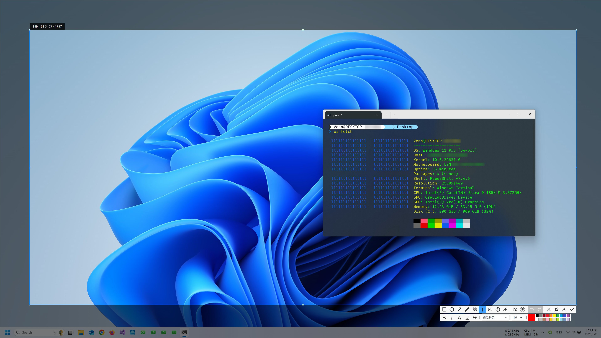</a> <a href="./_media/images/run_exhibition/win11_02.jpg">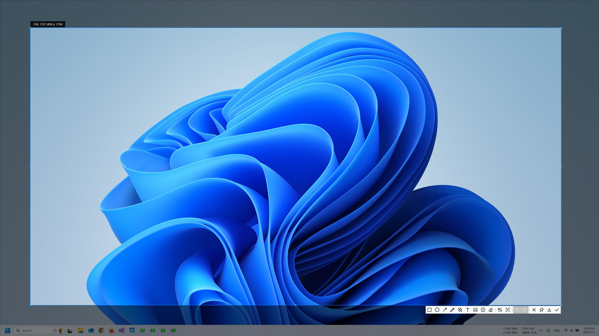</a>

<a href="./_media/images/run_exhibition/win11_03.jpg">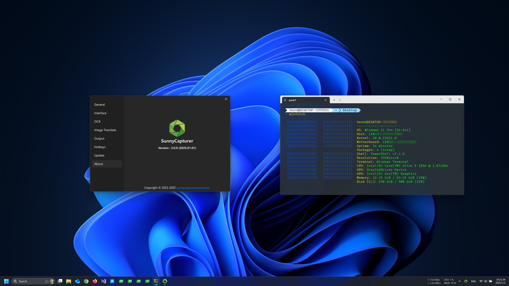</a>

### macOS 13

<a href="./_media/images/run_exhibition/macOS13_01.jpg">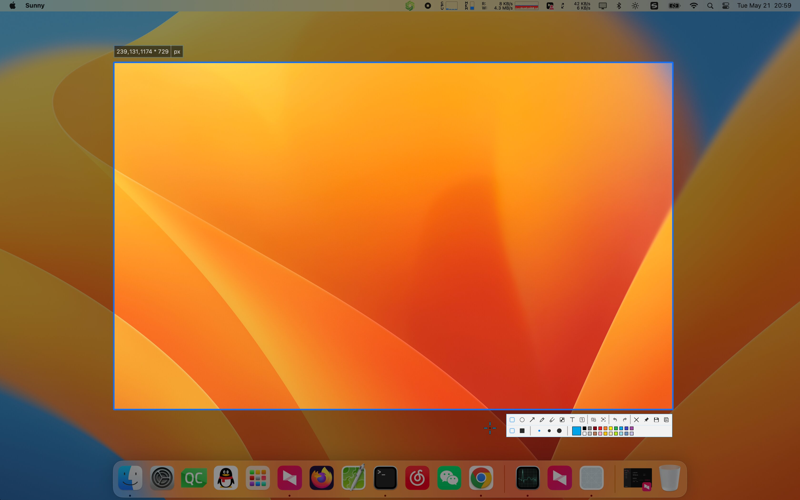</a> <a href="./_media/images/run_exhibition/macOS13_02.jpg">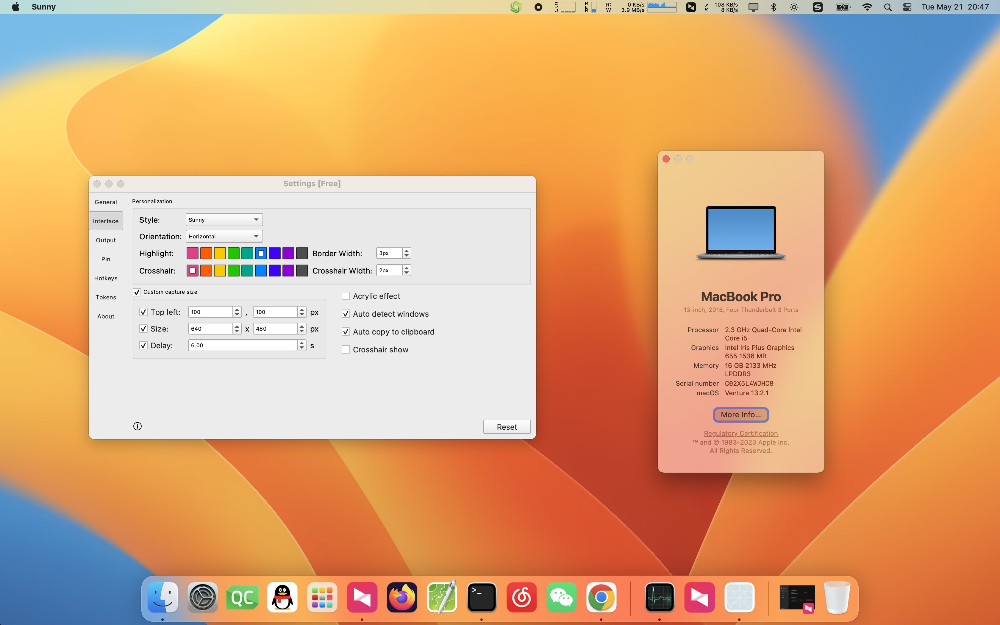</a>

### Debian 12

<a href="./_media/images/run_exhibition/Debian12_01.jpg">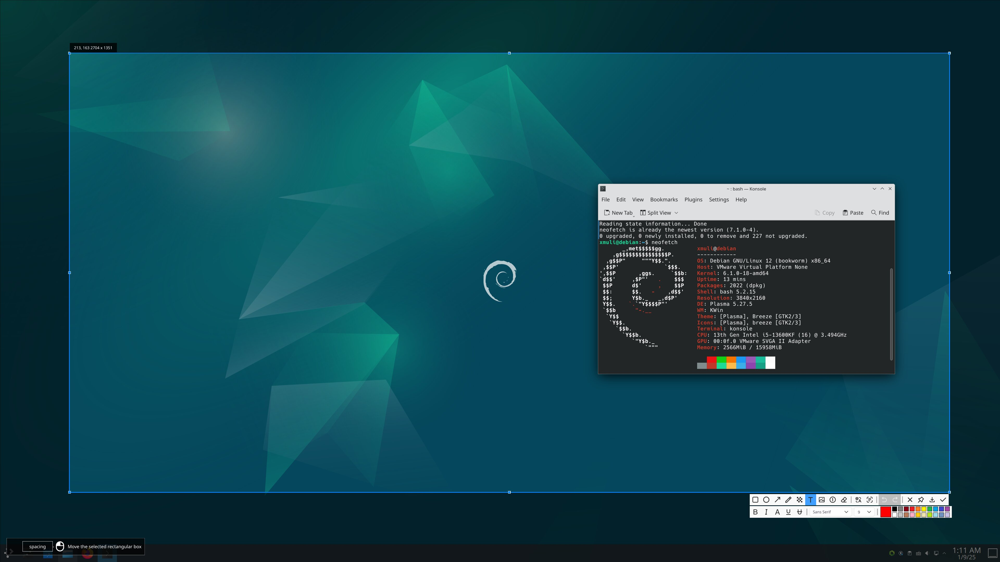</a> <a href="./_media/images/run_exhibition/Debian12_02.jpg">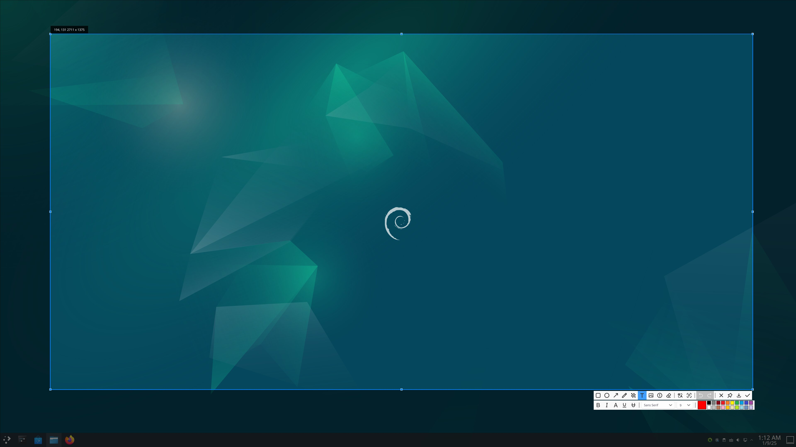</a>

<a href="./_media/images/run_exhibition/Debian12_03.jpg">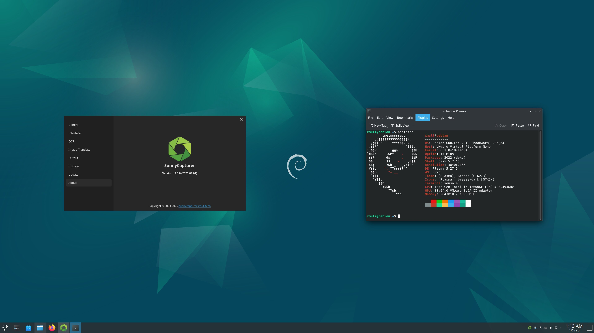</a>

### Ubuntu 20.04

 <a href="./_media/images/run_exhibition/Ubuntu20.04_02.jpg">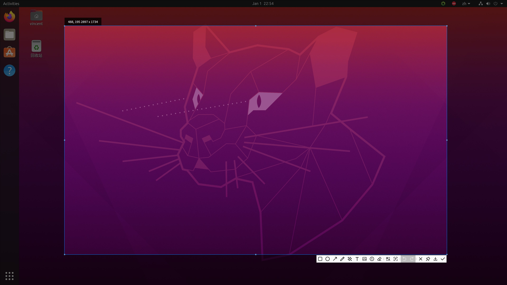</a>

### Ubuntu 24.04

<a href="./_media/images/run_exhibition/Ubuntu24.04_01.jpg">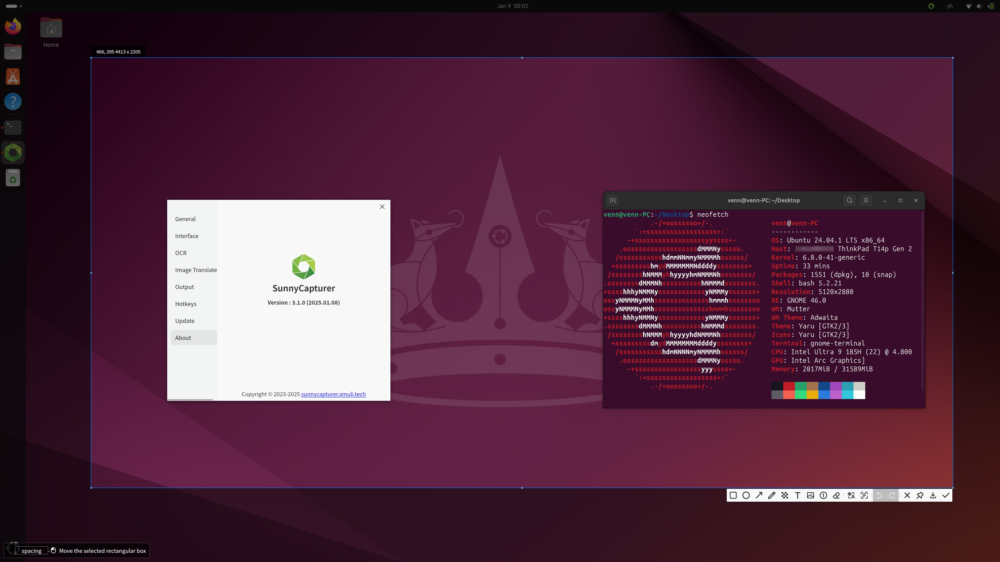</a> 

<a href="./_media/images/run_exhibition/Ubuntu24.04_03.jpg">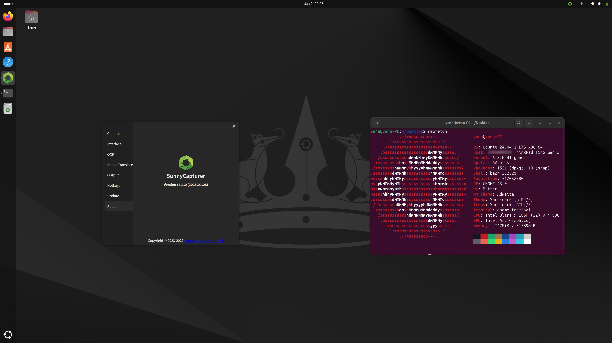</a> <a href="./_media/images/run_exhibition/Ubuntu24.04_04.jpg">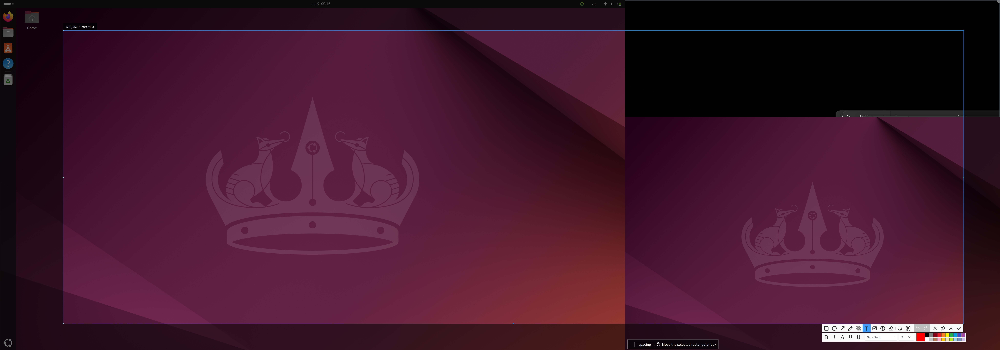</a>

### Deepin V23

<a href="./_media/images/run_exhibition/Deepin23_01.jpg">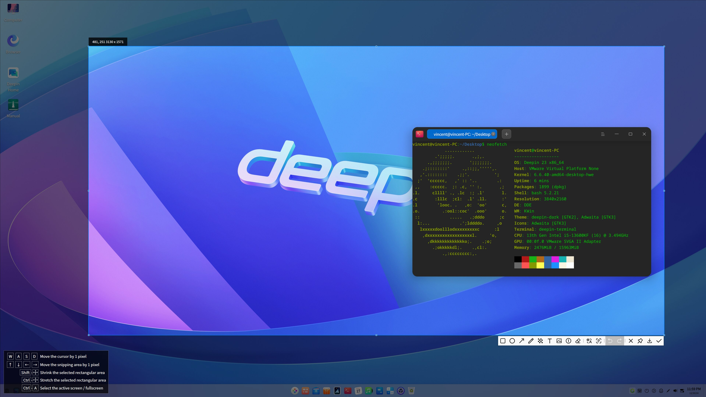</a> 

<a href="./_media/images/run_exhibition/Deepin23_03.jpg">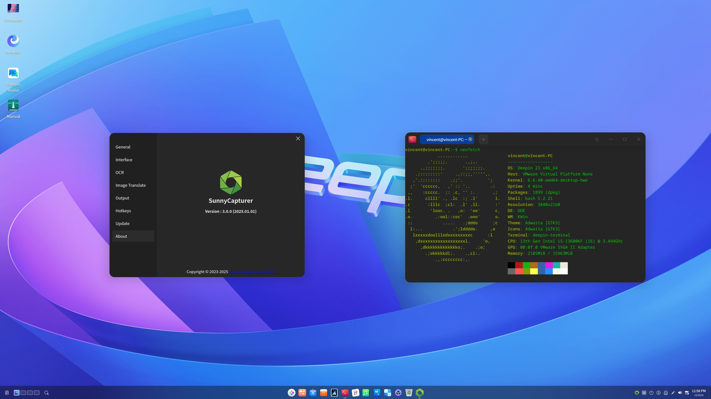</a>

### openKylin 2.0

### Deepin V23 · ARM64

### Deepin V23 · Loongson

<a href="./_media/images/run_exhibition/Loongson_Deepin_V23.jpg">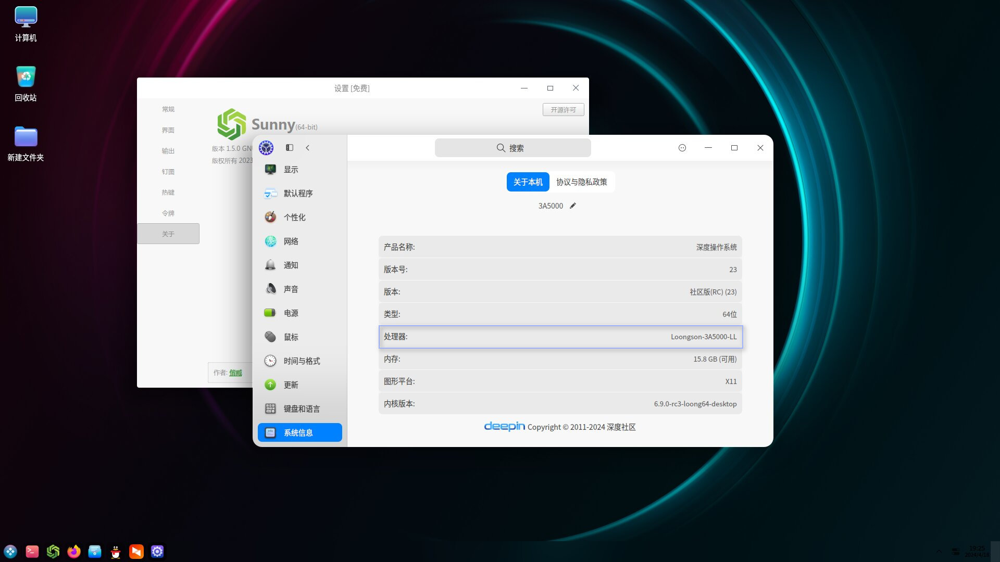</a>

## 状态

SunnyCapturer 已归档，不再进行功能更新。Windows 上的后续开发请使用 **SnipArc**。

## 链接

| | |
| --- | --- |
| **官网** | https://sunnycapturer.xmuli.tech/ |
| **完整兼容清单** | https://sunnycapturer.xmuli.tech/legacy-site.html#/zh-cn/supported_os |
| **作品档案条目** | https://screenshot-archive.xmuli.tech/sunnycapturer/ |
| **GitHub** | https://github.com/XMuli/SunnyCapturer |
| **历史发布** | https://github.com/XMuli/SunnyCapturer/releases |

## 截图作品系列

ShotX → FLIPPED → Sunny → SunnyCapturer → SnipArc。  
[完整作品档案](https://screenshot-archive.xmuli.tech/)

## 联系

- **Mosuzo 工作室** — https://mosuzo.com/
- **个人 GitHub** — https://github.com/XMuli
- **QQ 反馈群** — 418103279 · https://qm.qq.com/q/ff0xkauRdm
