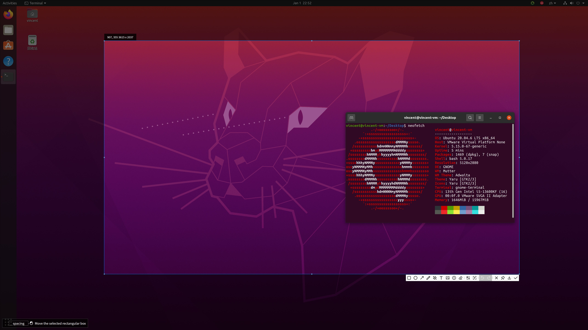
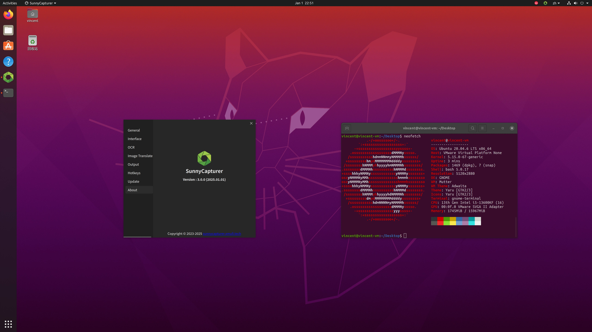
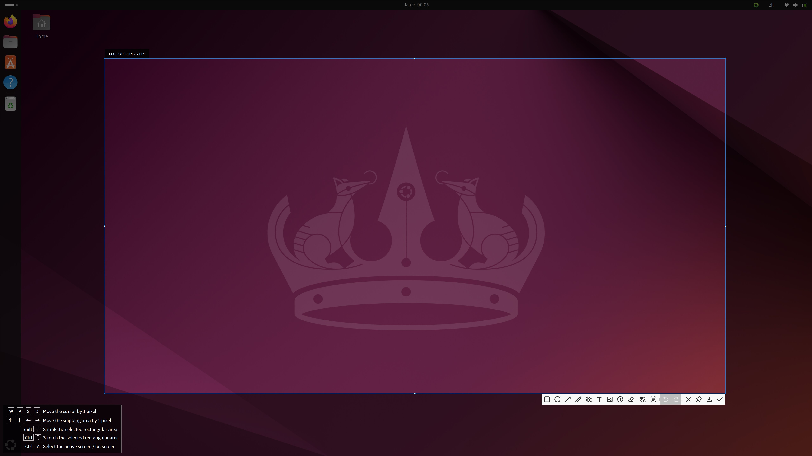
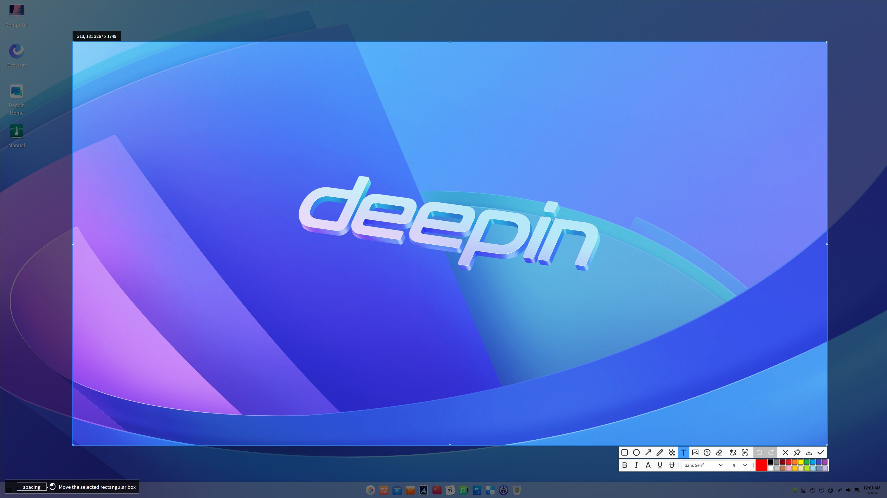
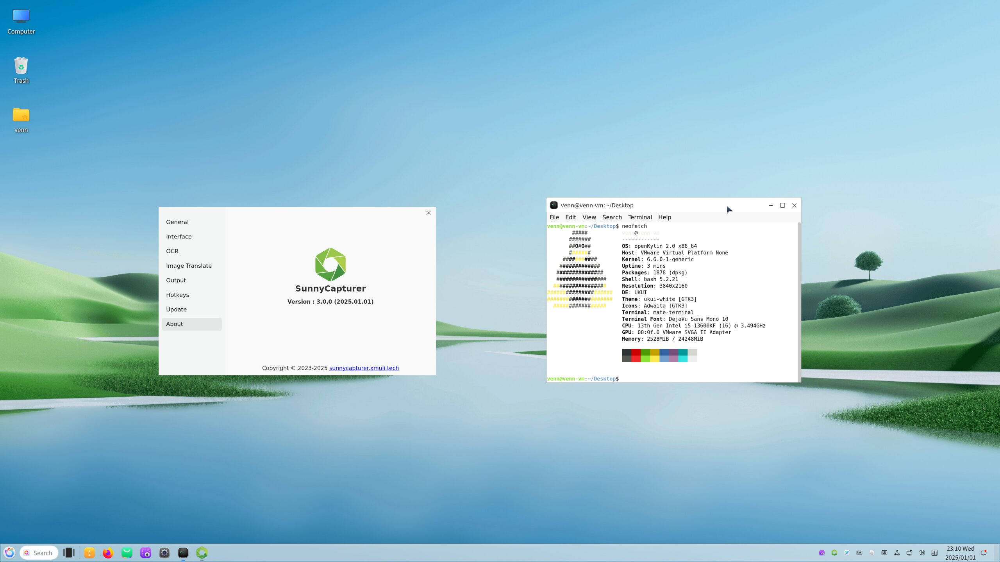
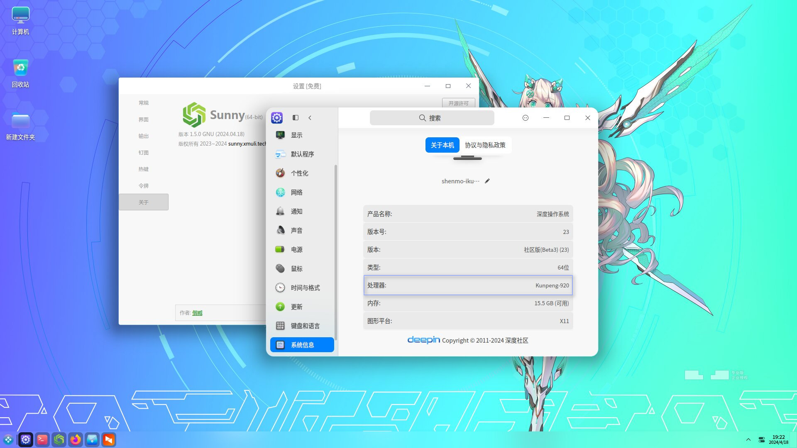

> [!IMPORTANT]
>  **从这里迁移到 SnipArc**
>
> **2026.11.28** · 欢迎迁移到下一代截图与标注工具 **SnipArc**。我们会持续更新和维护 SnipArc，欢迎下载体验。
>
> **[下载 SnipArc](https://sniparc.mosuzo.com/)** · [探索 Mosuzo Studio 的更多作品](https://mosuzo.com/)

---

# SunnyCapturer

适用于 Windows、macOS 和 Linux 的截图工具，支持标注、贴图、离线 OCR、图片翻译、录屏和 GIF 导出。

**最新版本 v5.3.0** · Qt / C++ · GitHub 历史下载约 4 万次

[原项目官网](https://sunnycapturer.xmuli.tech/) · [GitHub Releases](https://github.com/XMuli/SunnyCapturer/releases) · [作品档案](https://screenshot-archive.xmuli.tech/sunnycapturer/) · [English](README.md)

## 历史上架商店

| 商店 | 平台与入口 |
| --- | --- |
|  **Microsoft Store** | Windows · [SunnyCapturer](https://apps.microsoft.com/detail/9N1TPFK4NCBL) |
|  **深度应用商店** | Linux · 商店内搜索 SunnyCapturer 或 Sunny |
| **统信应用商店（UOS）** | Linux · 商店内搜索 SunnyCapturer 或 Sunny |
| **星火应用商店（Spark Store）** | Linux · 商店内搜索 SunnyCapturer 或 Sunny |

兼容清单也列有 openKylin 应用商店，暂未查到可核实的上架记录。

## 操作系统兼容性

| 平台 | 兼容清单记录的版本 | 架构 |
| --- | --- | --- |
|  **Windows** | 7、8、8.1、10、11，以及 Windows Server 2008 R2 至 2025 的部分版本 | x86-64 · ARM64 |
|  **macOS** | 13 Ventura · 14 Sonoma · 15 Sequoia | Intel · Apple Silicon（视版本） |
|  **Linux** | 见下方发行版列表 | x86-64 · AArch64 · LoongArch64 |

Windows 7 仅适用于 1.x–2.x 旧版。系统与架构的组合请以各版本发行包为准。

### Linux 发行版

 &nbsp;  &nbsp;  &nbsp;  &nbsp;  &nbsp;  &nbsp;  &nbsp; 

 &nbsp;  &nbsp;  &nbsp;  &nbsp;  &nbsp;  &nbsp; 

- **版本示例：** Debian 11 和 12、Ubuntu 20.04／22.04／24.04 LTS、Deepin 20.7–20.9／23／25、openKylin 1.0.2 和 2.0、CentOS 7。
- **清单中的其他发行版：** Arch Linux、BigLinux、CachyOS、Desktop Linux、Devuan、elementary OS、Fatdog64、Fedora、Gentoo、GXDE OS、Kali Linux、Kamuriki、KDE neon、Linux Mint、LMDE 6、Manjaro、NFSDesktop、Nobara、openEuler、openSUSE Leap、Parrot Security、Pop!_OS、Salix、铜豌豆（Tongwandou）、TUXEDO、统信 UOS、Windows Ubuntu、Zorin OS。

## 各系统运行截图

点击截图可查看原图。完整兼容清单见[支持的操作系统](./zh-cn/supported_os.md)。

### Windows 11

 

### macOS 13

 

### Debian 12

 

### Ubuntu 20.04

 

### Ubuntu 24.04

 

 

### Deepin V23

 

### openKylin 2.0

### Deepin V23 · ARM64

### Deepin V23 · Loongson

## 状态

SunnyCapturer 不再进行功能更新。Windows 上的后续开发请使用 **SnipArc**。

## 链接

| | |
| --- | --- |
| **官网** | https://sunnycapturer.xmuli.tech/ |
| **完整兼容清单** | https://sunnycapturer.xmuli.tech/legacy-site.html#/zh-cn/supported_os |
| **作品档案条目** | https://screenshot-archive.xmuli.tech/sunnycapturer/ |
| **GitHub** | https://github.com/XMuli/SunnyCapturer |
| **历史发布** | https://github.com/XMuli/SunnyCapturer/releases |

## 截图作品系列

ShotX → FLIPPED → Sunny → SunnyCapturer → SnipArc。  
[完整作品档案](https://screenshot-archive.xmuli.tech/)

## 许可证

Copyright (c) 2023–2026 WENGENG ZHANG

SunnyCapturer 的原创代码与文档采用 [GNU GPL v3.0](./LICENSE)（GPL-3.0-only）。历史源码快照与第三方组件保留各自的许可声明。

## 联系

- **Mosuzo 工作室** — https://mosuzo.com/
- **个人 GitHub** — https://github.com/XMuli
- **QQ 反馈群** — 418103279 · https://qm.qq.com/q/ff0xkauRdm
